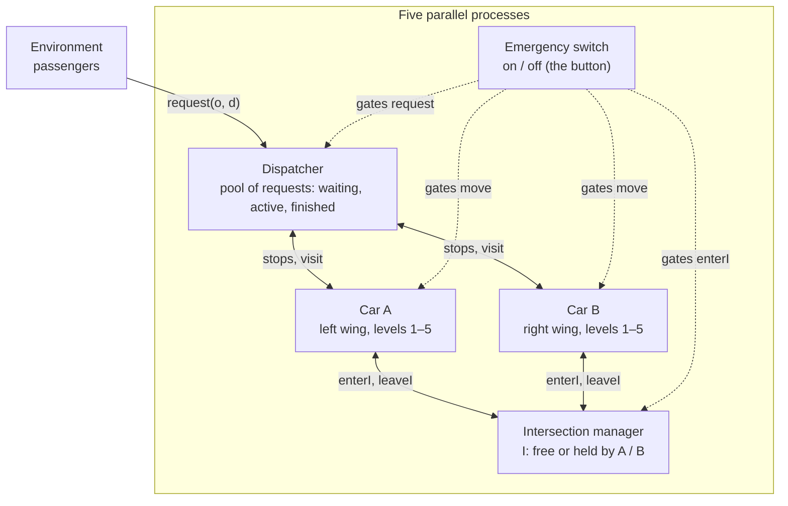

# Touchpoint Towers (mCRL2 Project)

Oct 6, 2026 · @teo · last updated Oct 25, 2026

Sections 1–4 describe the design as it is now implemented in `TouchpointTowers/TouchpointTowers_spec.mcrl2`. Section 5 records formula changes, section 6 the reasoning behind design and verification decisions, section 7 the verification status.

## 1. System description

Two elevators, each confined to its own wing, share exactly one floor: the Touchpoint I. It is both a crossing both cars pass through and the only place to change cars.

**Story:** An architect designs two towers after Michelangelo's *Creation of Adam*: two figures reaching for each other. The wings lean together and meet at a single floor halfway up. Unlike in the painting, the fingers do touch, and two elevator rails now pass through the same point.


(The sketch file is not in the repository yet.)

- Car A serves levels 1–5 of the left wing; car B serves levels 1–5 of the right wing.
- Level 3 is Touchpoint I, shared by both. Cars pass through it to get between low and high levels.
- A trip between wings is split into two legs: origin → I with one car, then I → destination with the other.
- Passengers use destination dispatch: they enter the destination at a terminal; the origin is implicit.

**Modelling goals.** Show that both cars obey the rules of the intersection, never move with open doors, serve every request, and hand transfer passengers over correctly, for every order in which requests arrive. Schedule optimality is out of scope.

**Abstractions / Assumptions:**

- Discrete levels; no time. A car jumps directly to its next stop in one atomic move.
- Requests are (origin, destination) pairs. Identical pool entries (same trip, same current leg, same state) merge; a request for a trip that is already under way stays a separate entry.
- The pool is bounded by the constant `MAXPOOL` (number of requests; one entry per request for the whole trip). A request is refused while the pool is full. The original design bound was 5; verified are `MAXPOOL = 1` (full model) and `MAXPOOL = 2` (per-property abstraction, §6.11). Car and floor capacity are unbounded.
- No passenger identities: the model tracks trips, not people.
- The number of levels is constant.

**Challenge:**

- **Forced cooperation:** neither car reaches the other wing, so cross-wing trips need both.
- **Shared resource:** I is a mutex, held briefly when passing and longer when stopping.
- **Handoff:** leg 2 may only start after leg 1 has dropped its passenger at I.
- **Bookkeeping vs. scheduling:** one stop can activate and complete several requests at once, while each car chooses its own visiting order.
- **Expected failure modes:** a car idling at I starves the other (prevented by the idle rule, §6.7); deadlocks around I once transfer capacity is bounded (that extension was dropped; floor area at I is unbounded).

## 2. Components



The cars never talk to each other directly: all coordination runs through the dispatcher (work) and the intersection manager (I). The dispatcher and the intersection manager do not need to communicate. The emergency switch plays the role of the emergency button; it takes part in every `move`, `request` and `enterI` and allows them only while no emergency is active. Whether it counts as part of the controller or of the environment is a presentation choice; without it the controller still has four components.

| Component | State | Responsibility |
| --- | --- | --- |
| Dispatcher | Pool: sorted, duplicate-free list of `req(origSrc, origDst, src, dst, st)` with st ∈ {waiting, active, finished} (§6.1, §6.3) | Accepts requests while the pool is not full; offers each car its stop set; on `visit(e, n)`: e's waiting entries starting at n become active, e's active entries ending at n become finished (home) or are rewritten into their second leg at I; reports `done(o, d)` for finished entries and removes them. |
| Car A, Car B (one process, parameter e) | Level, direction; phase (read / move / serve) and target | Reads its stop set (waits while it has no work, §6.5), picks the next level with LOOK (serving the current level if it has work there), moves in one atomic jump, opens, reports the visit, closes. Follows the intersection protocol (§6.6) and the idle rule at I (§6.7). |
| Intersection manager | `free` or `heldBy(e)` | Grants I to at most one car; only the holder can release it. |
| Emergency switch | on / off | `emergency` / `reset`; while on, no `move`, `request` or `enterI` can happen (§6.9). |
| Environment | — | Issues requests (and presses the emergency button, modelled by the switch). |

Stop set of car e = levels of the `src` of its waiting entries ∪ levels of the `dst` (current leg) of its active entries. Finished entries contribute nothing. The second leg of a cross-wing trip only exists once the passenger is at I, so no car visits I for a passenger who has not arrived yet (§6.1).

## 3. Actions

Locations are `Loc = struct I | fl(wing: Car, lvl: Nat)` with lvl ∈ {1, 2, 4, 5}; a car's position is a level 1–5, where 3 is I. Synchronised actions are built from halves with suffixes (`_d` dispatcher, `_c` car, `_im` intersection manager, `_em` emergency switch), fused by `comm` into the unsuffixed action below; `allow` only lets the fused actions through, so a half can never happen alone.

| Action | Parameters | Between | Meaning |
| --- | --- | --- | --- |
| `request(o, d)` | o, d: Loc, o ≠ d | Env → Dispatcher, gated by the switch | A passenger at o asks to travel to d (refused while the pool is full or during an emergency). |
| `stops(e, S)` | e: Car, S: FSet(Nat) | Dispatcher ↔ Car e | Car e reads the levels it must visit. |
| `move(e, f1, f2)` | e: Car, f1, f2: Nat | Car e, gated by the switch | Car e moves from level f1 to level f2. |
| `enterI(e)` | e: Car | Car e ↔ Intersection mgr ↔ switch | Car e is granted I; precedes crossing or entering moves. Three-party: no new grants during an emergency. |
| `leaveI(e)` | e: Car | Car e ↔ Intersection mgr | Car e has moved off or through level 3 and releases I. |
| `open(e)`, `close(e)` | e: Car | Car e | Doors of car e open / close. |
| `visit(e, n)` | e: Car, n: Nat | Car e ↔ Dispatcher | Car e serves level n with doors open; the dispatcher updates the pool. |
| `done(o, d)` | o, d: Loc | Dispatcher | The original request (o, d) is complete (after its last leg). |
| `emergency`, `reset` | — | Emergency switch | Emergency starts / ends. |

`pickup(e, o, d)` and `dropoff(e, o, d)` were part of the first design but are not modelled: boarding and alighting happen inside the dispatcher's pool update on `visit`. Consequence for S6: see §4 and §6.1.

## 4. Requirements

### Safety

| ID | Requirement | In terms of actions |
| --- | --- | --- |
| S1 | At most one car is in I. | Between `enterI(e)` and `leaveI(e)`, no `enterI(e')` with e' ≠ e. |
| S2 | No car passes through or stops at I without permission. | A `move(e, f1, f2)` with min(f1, f2) ≤ 3 ≤ max(f1, f2) only occurs after `enterI(e)` with no `leaveI(e)` in between. |
| S3 | A car never moves with open doors. | After `open(e)`, no `move(e, _, _)` before `close(e)`. |
| S4 | Service only happens with open doors. | `visit(e, n)` only occurs between `open(e)` and `close(e)`. |
| S5 | A car only serves levels where it has work. | After `stops(e, S)`, no `visit(e, n)` with n ∉ S before the next `stops(e, _)`. |
| S6 | Transfer passengers are handed over in order. | For a cross-wing request, `pickup(e₂, I, d)` never occurs before `dropoff(e₁, o, I)`. **Not model-checked**: holds by construction (the second leg is created only when the first car drops the passenger at I, §6.1); `pickup`/`dropoff` are not modelled and there are no passenger identities. |
| S7 | No phantom completions. | `done(o, d)` only occurs after `request(o, d)` with no `done(o, d)` in between. |
| S8 | Emergency stops both cars. | After `emergency`, no `move(e, _, _)` before `reset`. |
| S9 | A car never skips work. | After `stops(e, S)`, no `move(e, f1, f2)` has a level of S strictly between f1 and f2, before the next `stops(e, _)`. |
| S10 | Doors only open at a level where the car has work. | `open(e)` only occurs when the level the car last moved to (f2 of its last `move(e, f1, f2)`) is in its last stop set S. |

### Liveness

| ID | Requirement | In terms of actions |
| --- | --- | --- |
| L1 | No deadlock. | `[true*]<true>true` |
| L2 | Every request is served. | After `request(o, d)` made outside an emergency, `done(o, d)` inevitably follows on every path without further `request`, `emergency` or `reset`. |
| L3 | A request always remains servable. | After `request(o, d)`, `done(o, d)` stays reachable until it occurs. |
| L4 | No car parks at I. | After `enterI(e)`, `leaveI(e)` inevitably follows, under the same assumption as L2. |

### Scheduling (not formalised)

| ID | Requirement | In terms of actions |
| --- | --- | --- |
| P1 | LOOK: a car never reverses while work lies ahead. | A move is up if f2 > f1, else down. After `stops(e, S)`, a move against the previous direction only occurs when S has no level ahead in that direction. |

LOOK is implemented in the model (`target`, `newDir`), but P1 was never written as a formula; it is not part of the verified requirements.

### Sanity checks

A safety formula `[…] false` is also true if its actions never happen. Each property is backed by a reachability formula `<…> true` (files `R1`–`R9`) showing that its scenario actually occurs:

| ID | Formula | Supports |
| --- | --- | --- |
| R1, R2 | `<true* . enterI(A)> true`, same for B | S1, S2, L4 |
| R3 | `<true* . move(A, 2, 4)> true` (crossing I) | S2 |
| R4 | `<true* . open(A) . visit(A, 5)> true` | S3, S4, S10 |
| R5 | `<true* . stops(A, {1, 5})> true` (two-level stop set) | S5, S9 |
| R6 | `<true* . done(fl(A, 1), fl(A, 5))> true` | S7, L2, L3 |
| R7 | `<true* . done(fl(A, 1), fl(B, 4))> true` (cross-wing) | S6, L2, L3 |
| R8 | `<true* . emergency . (!reset)* . reset . true* . exists f1, f2: Nat . move(A, f1, f2)> true` | S8 |
| R9 | `<true* . stops(A, {}) . move(A, 3, 4)> true` (idle rule) | L4 |

R5 is false at `MAXPOOL = 1`: with one request a stop set has at most one level, so S9 is vacuous there. At `MAXPOOL = 2` R5 is true.

## 5. Formula revisions

A record of formulas that had to change, and why, for the report.

### S2: quantifier moved inside the action (2026-10-20)

**Original** (`TouchpointTowers/properties/S2.mcf`, 18 Oct):

```
forall e: Car .
forall f1,f2: Nat .
  val(((f1 <= 3) && (3 <= f2)) ||
      ((f2 <= 3) && (3 <= f1))) =>
  (
    [(!enterI(e))* . move(e,f1,f2)] false
    &&
    [true* . leaveI(e) . (!enterI(e))* .
      move(e,f1,f2)] false
  )
```

**Problem:** the check never terminates. The outer `forall f1, f2: Nat` asks the solver to check the formula for every pair of natural numbers that satisfies the condition, and there are infinitely many (`f2` can be 3, 4, 5, …, 10 000, …). The solver enumerates them one by one, forever, regardless of model size. (S5 and S9 also quantify over `Nat` at the top level, but bound it with `val(n >= 1 && n <= 5)`, which is why they terminate.)

**Revised** (same meaning, as in the report's draft):

```
forall e: Car .
  (
    [(!enterI(e))* .
      (exists f1,f2: Nat .
        val((f1 <= 3 && 3 <= f2) || (f2 <= 3 && 3 <= f1)) && move(e,f1,f2))] false
    &&
    [true* . leaveI(e) . (!enterI(e))* .
      (exists f1,f2: Nat .
        val((f1 <= 3 && 3 <= f2) || (f2 <= 3 && 3 <= f1)) && move(e,f1,f2))] false
  )
```

With the `exists` inside the action formula, `f1` and `f2` only range over moves that the model can actually perform at that point, which are finitely many. The requirement itself is unchanged: every move whose range includes level 3 lies between an `enterI(e)` and the next `leaveI(e)`.

### S7: counter capped, locations bounded (2026-10-21)

**Original** (`TouchpointTowers/properties/S7.mcf`, 18 Oct):

```
forall o,d: Loc .
  nu X(accepted: Nat = 0, finished: Nat = 0) .
  (
    [request(o,d)] X(accepted + 1, finished)
    &&
    [done(o,d)]
      (val(finished < accepted) &&
       X(accepted, finished + 1))
    &&
    [!(request(o,d) || done(o,d))]
      X(accepted, finished)
  )
```

**Problems:** the check never terminates, for two reasons.
1. *Unbounded counters.* Requests can happen forever (request, done, request, done, …), so `accepted` and `finished` grow without limit, and the solver creates a separate equation for every combination: `X(0,0)`, `X(1,0)`, `X(1,1)`, `X(2,1)`, …
2. *Unbounded locations.* The outer `forall o,d: Loc` ranges over every `Loc`, including invalid ones like `fl(A, 17)`, which are infinitely many (the same issue as S2).

**Revised:**

```
forall o, d: Loc . val(validLoc(o) && validLoc(d)) =>
  nu X(k: Nat = 0) .
  (
    [request(o, d)] X(min(k + 1, MAXPOOL))
    &&
    [done(o, d)] (val(k > 0) && X(if(k > 0, Int2Nat(k - 1), 0)))
    &&
    [!(request(o, d) || done(o, d))] X(k)
  )
```

- Only the difference between accepted and finished matters, so one counter `k` (outstanding requests) replaces the two.
- `k` is **capped at `MAXPOOL`**. This is sound: the capped `k` is never larger than the real number of outstanding requests, so a `done` that passes the capped check (`k > 0`) also passes the original one. It cannot fail spuriously either: completions without an intervening request are bounded by the number of pool entries for `(o, d)`, which is at most `MAXPOOL`, and the capped `k` never drops below that number.
- `val(validLoc(o) && validLoc(d)) =>` restricts the check to real locations. This does not weaken it: `request` and `done` only ever occur with valid locations.

### L3: locations bounded (2026-10-21)

**Original** (`TouchpointTowers/properties/L3.mcf`, 18 Oct):

```
forall o,d: Loc .
  [true* . request(o,d) . (!done(o,d))*]
    <true* . done(o,d)> true
```

**Problem:** the same as S2 and S7: the outer `forall o,d: Loc` ranges over infinitely many locations, and every value gets its own equations, so the check cannot terminate.

**Revised:** `forall o, d: Loc . val(validLoc(o) && validLoc(d)) => …`, rest unchanged. Not a weakening, for the same reason as S7.

**L2 needed no bound:** L2 quantifies `forall o,d: Loc` directly in front of `[request(o,d)]`, inside the outer fixpoint; the solver eliminates it by matching the action. L2 terminated at `MAXPOOL = 1` (14.6 s) unchanged. At `MAXPOOL = 2` it is checked per origin (§6.11), which is a verification technique, not a change of the formula.

### S6: commented out (2026-10-21)

The draft `S6.mcf` used `request(i, o, d)` with a request ID and `pickup`/`dropoff` actions, none of which exist in the model. Decision: S6 holds by construction (§6.1) and is not model-checked. The file now contains only comments: the reasoning and the original draft.

## 6. Design decisions

The reasoning behind non-obvious modelling choices, for the report's design and discussion sections.

### 6.1 Cross-wing requests (2026-10-20/21)

**Starting point.** The first working model handled same-wing trips only. A request was a triple `req(src, dst, st)` with `st ∈ {waiting, active}`: `waiting` means the passenger stands at `src`, `active` means they are in the car on the way to `dst`. A visit by car `e` at level `n` boards waiting passengers whose `src` is there and drops active passengers whose `dst` is there. The question was how to extend this to trips between wings with as little disruption as possible.

**What a cross-wing trip needs.** A trip 1A → 4B is two legs: car A takes the passenger 1A → I, then car B takes them I → 4B. Two constraints:
- **Order:** leg 2 may only start once the passenger has actually been dropped at I (S6).
- **Ownership:** each leg must be served by the right car. This was already guaranteed: `owner` takes the wing of whichever end of the leg is not I, so `(1A → I)` belongs to A and `(I → 4B)` to B.

**Why the existing two states are not enough for leg 2.**
- If leg 2 were stored as `waiting` from the start, B would see a stop at I and go there before the passenger has arrived.
- If it were `active`, B would "drop off" at 4B without ever having picked anyone up.

So leg 2 needs a third state, `blocked`, that contributes no stops until leg 1 is done.

**The unblocking problem.** The first idea was: "when A visits I, unblock all of B's blocked legs". This is wrong. A visit at I by A does not mean every cross-wing passenger has arrived. A may stop at I on its way up and still have to pick up other cross-wing passengers higher in its wing. Unblocking all of them would let B pick up passengers who are not there yet. Unblocking has to be *per passenger*: release exactly the leg 2 whose leg 1 just ended at I.

**Root cause.** A triple cannot say which leg belongs to which trip. `req(1A, I, active)` could be leg 1 of 1A → 4B, of 1A → 5B, or a plain request 1A → I. So the dispatcher cannot know which blocked leg to release.

**Option 1: two entries from the start, linked by the original request.** Each entry stores the original request next to its own leg, e.g. leg 1 `(1A, 4B | 1A → I, waiting)` and leg 2 `(1A, 4B | I → 4B, blocked)`. When leg 1 is dropped at I, the blocked leg with the same original request is released. This matches the first report draft (legs blocked / waiting / active).
- *Drawback: the merge trap.* Identical entries are merged by `ins`. Suppose a second passenger requests 1A → 4B while the first is already riding in A. The second passenger's leg 1 is new (`waiting`, the first one is `active`), but their blocked leg 2 is identical to the first passenger's and merges with it. When the first passenger reaches I, the single merged leg 2 is released for them. When the second passenger later arrives at I, there is no leg 2 left: they are stranded. Avoiding this needs an extra guard on requests.

**Option 2: one entry per request, rewritten at I.** At request time only leg 1 is stored, together with the original request. When A drops the passenger at I, `afterVisit` *replaces* the entry by its second leg, `waiting` at I, for B.
- **Order by construction:** leg 2 exists exactly when the passenger is physically at I. There is no unblocking rule to get wrong.
- **No `blocked` state** needed.
- **No stranding:** two passengers on the same trip at different stages stay separate entries (one `waiting`, one `active`), and each gets its own rewrite at I. If they end up waiting at I at the same time, they merge, which is correct: B picks them up in the same visit.
- **One pool slot per request** for the whole trip (one entry out, one in), so `MAXPOOL` keeps meaning "number of requests".
- **`owner` and `stopsOf` need no change**, since they work on the current leg.

**Decision: option 2.** It needs less state, cannot strand anyone, and guarantees the order structurally rather than through a rule.

**How many extra fields.** The completion report `done(o, d)` must name the *original* request, because L2, L3 and S7 match it against `request(o, d)`. After the rewrite at I, the leg starts at I, so the original origin would be lost without an extra field. Two variants were considered:
- *One extra field:* `dst` always holds the final destination and never changes; only `src` changes (1A → I). The current leg's target is computed when needed (`I` if `src` and `dst` are in different wings, else `dst`). Only the original origin is stored extra.
- *Two extra fields:* store the original origin and destination (`origSrc`, `origDst`), plus the current leg as `src`/`dst`, which both change at I.

Both have the same state space: in the second variant, the extra field is fully determined by the others, so it adds no states. **Chosen: two extra fields**, for readability. The current leg can be read directly from the entry instead of being recomputed, which also keeps `stopsOf` and `afterVisit` simple.

Resulting entry: `req(origSrc, origDst, src, dst, st)`. A new request is created by `newReq(o, d) = req(o, d, o, if(sameWing(o, d), d, I), waiting)`. Example 1A → 4B:

| Step | Entry | Serving car |
| --- | --- | --- |
| request | `(1A, 4B, 1A, I, waiting)` | A, pick up at 1 |
| A visits 1 | `(1A, 4B, 1A, I, active)` | A, drop off at I |
| A visits I | rewritten to `(1A, 4B, I, 4B, waiting)` | B, pick up at I |
| B visits I | `(1A, 4B, I, 4B, active)` | B, drop off at 4 |
| B visits 4 | `(1A, 4B, I, 4B, finished)` | reported as `done(1A, 4B)` |

**Consequence for the report.** Assumption 3 of the first draft ("leg 2 stays blocked until…") must be rewritten: the second leg is created when the passenger arrives at I. S6 is argued by construction and not model-checked (decided 2026-10-21; §5).

### 6.2 Completion reporting: `done` (2026-10-20)

**Why have `done` at all.** We considered dropping it and stating the liveness requirements over visits instead ("after `request(1A, 4B)`, eventually `visit(A, 1)`, then `visit(A, 3)`, `visit(B, 3)`, `visit(B, 4)`"). Rejected because:
- the formulas get long, especially for cross-wing trips;
- they are weaker: those visits can happen for *other* passengers, so a dispatcher that silently forgot a request could still pass;
- S7 (no phantom completions) has no meaning without a completion event.

`done` makes the dispatcher's bookkeeping itself observable.

**Why a `finished` state.** One visit can complete several requests at once, so `done` cannot simply be part of `visit`. Instead `afterVisit` marks completed requests `finished` (they contribute no stops), and the dispatcher reports and removes them separately.

**Why a branch, not a mode.** Reporting is one more `+` branch of the dispatcher, offered whenever a finished request exists, rather than a separate clean-up phase. A phase would block requests and visits until clean-up is over. A branch can interleave with everything else, and since only the dispatcher takes part, it can never block another component.

**Why sum over locations.** The branch is `sum o, d: Loc . (validLoc(o) && validLoc(d) && hasFinished(o, d, pool)) -> done(o, d) . Dispatcher(removeFinished(o, d, pool))` rather than a sum over pool entries. The tools must enumerate every `sum`, and sums over `Loc` with `validLoc` guards are known to work (the request branch uses the same pattern).

### 6.3 Pool as a sorted list (2026-10-08)

The pool is a `List(Req)` kept sorted and duplicate-free by `ins`, not an `FSet`. mCRL2 cannot pattern-match on `FSet` (tested: a recursive function over `{x} + s` never evaluates), so the recursive functions the dispatcher needs (`stopsOf`, `afterVisit`, `hasFinished`, `removeFinished`) cannot be written over a set. A plain list would make `[x, y]` and `[y, x]` different states for the same pool; keeping it sorted (with the `<` that mCRL2 generates for every struct) makes it canonical. Stop sets stay `FSet(Nat)`, since they only need membership tests (`n in S`).

### 6.4 Dispatcher without phases (2026-10-13)

The first idea was a cycle: bookkeeping → send car A its stops → send car B its stops → wait. With blocking handshakes this deadlocks: the dispatcher waits for car B to take its stops while car B waits for the dispatcher to accept its `visit`. Instead, all branches (request, offer stops, accept visit, report done) are always offered with `+`; the bookkeeping is simply the new parameter value of each transition. The stop set is computed (`stopsOf(e, pool)`) whenever a car reads it, so it is always up to date.

### 6.5 Cars pull their stop set and wait when idle (2026-10-13)

A car reads its stop set with `sum S: FSet(Nat) . (S != {} || pos == 3) -> stops_c(e, S)`: the handshake fixes `S` to the dispatcher's offer. The guard `S != {}` makes a car without work *wait* instead of reading an empty set again and again; such polling would be an infinite loop of `stops` actions (a livelock) and would break the "inevitably" in L2 and L4. A car reads its stop set once per cycle (read → move → open → visit → close → read).

**Serving the current level is allowed.** If the car's current level is in its stop set, it serves it without moving. Forbidding this would starve a passenger who requests at the car's level when there is no other work (L2 would fail). It cannot livelock: a visit always removes that level from the stop set, unless the environment keeps making new requests there, which L2's assumption excludes.

**LOOK.** `target(pos, dir, S)`: the current level if it has work, otherwise the nearest stop ahead in the current direction, otherwise the nearest stop behind (reverse). `newDir` gives the matching direction. `nextUp`/`nextDown` scan level by level and return 0 for "none".

**Conditional equations.** `nextUp`/`nextDown` are defined with conditional equations (`n < 5 -> nextUp(n, S) = …`), not with `if(…)`. With `if`, `mcrl22lps` looped forever: during linearisation the position is still a variable, the stopping condition `n >= 5` cannot be decided, and the rewriter unfolds `nextUp(n + 1, S)`, `nextUp(n + 2, S)`, … endlessly. A conditional equation only fires once its condition is decidable. Demonstrated with `mcrl2i` (the `if` version hangs on an unknown argument; the conditional version returns it unevaluated).

### 6.6 Intersection protocol (2026-10-20)

Observation: a car holds I exactly when it is at level 3, or inside its own crossing move. This avoids an extra flag. A move from `pos` to `t`:

| Move | Sequence |
| --- | --- |
| does not touch 3 | `move` |
| arrives at 3 | `enterI . move` (keep I while serving) |
| leaves 3 | `move . leaveI` |
| passes through 3 | `enterI . move . leaveI` |

Written as an if-else chain in `Go`; checked strongly bisimilar (with `ltscompare`) to an equivalent two-question version ("need to enter?" / "need to leave?"). The intersection manager is two lines: when free, any car may `enterI`; when held, only the holder may `leaveI`.

### 6.7 Idle rule at I (2026-10-20)

A car without work blocks (§6.5). If it blocks at level 3, it holds I forever and starves the other car (L4 fails). Rule: a car at level 3 reads its stop set even when it is empty, and with `{}` moves one level on in its current direction (`moveOne`: up → 4, down → 2), then releases I. It does not open its doors: that would violate S10 (doors only open where there is work), and a `visit` there would violate S5. The car still reads the empty set first (a real handshake), so it never leaves I while a passenger is waiting there.

### 6.8 Linearisation pitfall: two `stops_c` branches (2026-10-21)

The work branch and the idle branch were first written as two separate `stops_c` summands. The linearizer clustered them into one summand with an `if`, after which `lpssumelm` could no longer eliminate `sum S: FSet(Nat)`, and state space generation failed with "Cannot enumerate elements of finite set sort FSet(Nat)" (the property checker kept trying forever). Fix: one `stops_c` branch with an inner if-then-else (`(S != {}) -> Go(…) <> move_c(…) . leaveI_c(e) . …`).

### 6.9 Emergency as a pause (2026-10-21)

**Goal:** an emergency pauses the system and does not reset it; if it discarded requests, "every request is eventually served" would be false. All state is preserved and the system continues after `reset`.

**Design:** a fifth process, the emergency switch (on/off), plays the button. `move`, `request` and `enterI` must synchronise with it, and it only allows them while off. Everything else (stop-set reads, visits, `done`, the intersection manager) is bookkeeping and continues; a car that is serving a floor may finish (open, visit, close). Moves are atomic, so there is no "mid-move" to interrupt. Doors are not opened by the emergency, because that would contradict S10. Compared with the first design (both cars synchronise on `emergency`/`reset`), the cars barely change: `move` became a half that needs the switch.

**`enterI` gating found by review:** the first version gated only `move` and `request`. Reviewing L4 before running it showed that a car could acquire I during an emergency and then be unable to move; L4 ("`leaveI` inevitably follows", excluding paths through an emergency) then fails, because that `enterI` happens *after* the emergency started. Fix: `enterI` became a three-party synchronisation with the switch. Later confirmed with a mutant: without the gating, L4 = false.

**Requests during an emergency** are impossible (the switch blocks them), which resolves the "emergency vs. L2" pitfall; L2's `normal` flag would also cover it.

### 6.10 Sanity checks (2026-10-21)

Every safety property is backed by a reachability check (§4, R1–R9), because a safety formula over actions that never happen is vacuously true. R5 revealed that S9 is vacuous at `MAXPOOL = 1`: with one request a stop set never has two levels, so there is nothing to skip. This, together with scenarios that need two requests at once (stale stop sets, merging, two busy cars), is why verification at `MAXPOOL = 2` mattered (§6.11).

### 6.11 Verification at MAXPOOL = 2: diagnosis and per-property abstraction (2026-10-25)

**Problem.** At `MAXPOOL = 1` the full model was verified, but there S9 is vacuous (a stop set never has two levels; sanity check R5 is false), and scenarios with two requests at once (stale stop sets, merging, two busy cars) do not occur. At `MAXPOOL = 2` the state space was generated without trouble (27.3M states, 25 min; 18.8M after strong-bisimulation reduction), but checking ran out of memory overnight: `lts2pbes` ran 1.9 h on S1 without a result, and on S2 the system was swapping (9.8 GB peak, 0.3 GB free).

**Hypotheses investigated** (following the tutor's hints: a model bug, infinite unfolding in a formula, or the checking method):
1. *Model bug / redundant state.* Checked whether the stop set `S` and the target `t`, which a car only needs briefly, stay in the state as stale values. They do not: the linearised process resets them to a dummy value, and `lpsstategraph` (dead-variable analysis) removes nothing. The 27M states are genuine. They come from pool combinations (about 280 possible pool entries), two independently moving cars, and the emergency switch, which exactly doubles the state space (63,425 vs 126,850 states at `MAXPOOL = 1`).
2. *Infinite unfolding in the formulas.* Every formula reviewed: all quantifiers are bounded (`validLoc`, `n` in 1..5), inside an action, or directly in front of a box with that action (eliminated by matching); all fixpoint parameters are finite. The non-terminating formulas found earlier (S2, S7, L3) were already fixed (section 5). Measured cost: 2.5 equations per state for S1, 11.7 for S9 (`forall e` × `forall n` = 10 instances).
3. *Checking method.* Memory measured at `MAXPOOL = 1` and scaled up: the on-the-fly route (`lps2pbes` + `pbessolve`) would need about 30 GB, the route used (`lts2pbes` on the LTS) about 50 GB, because it first builds an explicit equation system per state and then solves it. PBES simplification (`pbesconstelm`, `pbesparelm`, `pbesstategraph`) changed nothing (S1, S9), since every state variable influences behaviour.

**Conclusion:** no bug. Plain checking at 27M states needs 2–3× the RAM of a 16 GB laptop.

**Options considered.** The guideline was to reduce *enough* to run on the laptop, not as much as possible.
- *Model changes:* a car storing only target and a park flag instead of its stop set (−9% at `MAXPOOL = 1`); reporting `done` immediately after a visit (+2%). Not worth changing the model for.
- *Leaving out the emergency* for safety properties that do not mention it: sound, because the switch only blocks behaviour and never adds any (every run of the full model with `emergency`/`reset` removed is a run of the emergency-free model). Halves the state space; kept as an argument, not needed in the end.
- *Tau-confluence* (`lpsconfcheck`, then `lps2lts -cctau`): reduces during generation (6× fewer states for S9 at `MAXPOOL = 1`), but only works single-threaded and is slow at `MAXPOOL = 2`. Not used.
- **Per-property abstraction (chosen):** for each group of properties, hide the actions their formulas do not mention (they become internal `tau` steps), minimise modulo branching bisimulation (divergence-preserving for the liveness properties L1, L2, L4, where infinite internal loops matter), and check on the result.

**Why it is sound.** Hiding only renames actions that a formula never mentions; the formula treats them exactly like `tau` (they are matched by `true` or by a negation). Branching bisimulation preserves every formula that is insensitive to inserting or removing internal steps; ours are, because their regular expressions always put a `*` between actions and S7/S10 loop on "any other action". Hiding a few actions *fewer* than a formula needs is still sound (just less reduction), which lets properties share one reduction run. Exception: the sanity checks R4 and R9 require two actions directly after each other, so they are taken from the full `MAXPOOL = 1` run only.

**Validation** (`MAXPOOL = 1`):
- every property gives the same result on its reduced state space as on the full one;
- a mutant with the old L4 bug (`enterI` not gated by the emergency switch) is still caught: L4 = false on the full and on the reduced state space.

**Balance.** From the `MAXPOOL = 1` measurements (0.17 GB for checking 59k states), each checked state space should stay below about 1M states. Properties were grouped by the actions they mention, giving 8–9 reduction runs on the existing 18.8M-state LTS instead of 13 (`scripts/verify_reduced.ps1`).

**First `MAXPOOL = 2` results.** Each reduction took about 4 minutes.
- {stops, move, open} → 1.1M states: **S9, S10, R5 true**. R5 = true means S9 is no longer vacuous.
- {enterI, leaveI, move} → 0.72M states: **S1, S2 true**.

**Second problem: formulas over all 72 trips.** The group {request, done, emergency, reset} reduced to 2.25M states, much more than estimated, because which requests are outstanding has to stay visible. S7, L2 and L3 quantify over all 72 trips `(o, d)`, so the solver works on 72 instances at once: 12.6 GB committed, swapping. Stopped.

**Fix.**
- *Split the group:* S7, L3 (and R6, R7) do not mention emergency/reset and are safety/reachability properties, so they use the smaller plain branching reduction of {request, done}. Only L2 keeps {request, done, emergency, reset} with the divergence-preserving variant.
- *Per-trip checking:* a formula "for all trips (o, d): φ(o, d)" is true iff φ(P, Q) holds for each of the 72 trips. Each instance needs about 1/72 of the memory; the total work is the same. Instances are made by a textual change of the formula file:
  - S7, L3: the bound `val(validLoc(o) && validLoc(d))` becomes `val(o == P && d == Q)`.
  - L2: the obligation guard `val(!normal)` becomes `val(!normal || !(o == P && d == Q))`. Only the "inevitably `done`" obligation is restricted to trip (P, Q); the outer loop over all requests, emergencies and resets is unchanged. (Restricting the outer `forall` itself would stop following runs after requests for other trips, which would weaken the formula.)
- Validated at `MAXPOOL = 1`: S7, L3 and L2 are each true for 72 of 72 trips, matching the single-formula results.
- *Per trip was too slow; per origin instead.* At `MAXPOOL = 2` each per-trip check took ~2.4 min (1,751 s for the first 12 trips), almost all of it spent loading the 653k-state reduced LTS, so 72 checks per property would have taken ~3 h. Grouping the trips by origin gives 9 instances of 8 trips each: still a conjunction equal to the original formula, ~1/9 of the all-at-once memory, and 8× less loading overhead. Instances: S7, L3: `val(validLoc(o) && validLoc(d))` becomes `val(o == P && validLoc(d))`; L2: `val(!normal)` becomes `val(!normal || !(o == P))`. Validated at `MAXPOOL = 1` (9 of 9 true for each). The fast groups were moved before the request groups so their results come in first.

**Per-origin timings at `MAXPOOL = 2`:** S7 4,382 s (~8 min per origin), L3 2,424 s, L2 6,846 s (~13 min per origin, on the 2.25M-state reduction). No group needed further splitting; every step stayed within 16 GB. Final table: `docs/results.md`.

## 7. Verification status (final, 2026-10-25, 23:06)

Details, timings and commands: `docs/results.md`. Scripts: `scripts/verify.ps1` (full pipeline), `scripts/verify_reduced.ps1` (per-property abstraction).

| Bound | Method | Result |
| --- | --- | --- |
| `MAXPOOL = 1` (126,850 states) | full state space | all S/L properties true (S6 by construction); R1–R9 true except R5 (expected) |
| `MAXPOOL = 2` (27.3M states) | per-property abstraction | **all S/L properties true** (S6 by construction; S7, L3, L2 per origin, 9 of 9 each); R1–R3, R5–R8 true. R5 true: S9 is meaningful at this bound |

Not covered at `MAXPOOL = 2` by a direct check: S6 (by construction, any bound), R4 and R9 (minimisation does not preserve "directly after each other"). R4 and R9 still hold at `MAXPOOL = 2` by monotonicity: `MAXPOOL` occurs only in the request guard, so every run at 1 is a run at 2 and the witness paths found at 1 exist at 2. (Conversely, safety at 2 implies safety at 1.) The verified spec copy is identical to the current spec apart from the MAXPOOL value.
