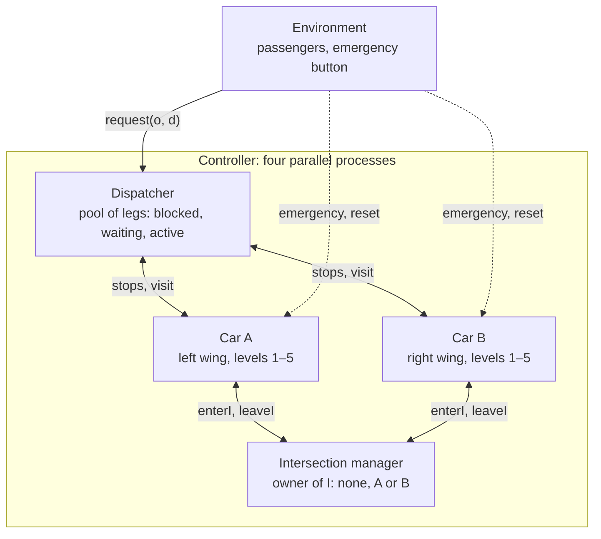

# Touchpoint Towers (mCRL2 Project)

Oct 6, 2026 · @teo

## 1. System description

Two elevators, each confined to its own wing, share exactly one floor: the Touchpoint I. It is both a crossing both cars pass through and the only place to change cars.

**Story:** An architect designs two towers after Michelangelo's *Creation of Adam*: two figures reaching for each other. The wings lean together and meet at a single floor halfway up. Unlike in the painting, the fingers do touch, and two elevator rails now pass through the same point.


- Car A serves levels 1–5 of the left wing; car B serves levels 1–5 of the right wing.
- Level 3 is Touchpoint I, shared by both. Cars pass through it to get between low and high levels.
- A trip between wings is split into two legs: origin → I with one car, then I → destination with the other.
- Passengers use destination dispatch: they enter the destination at a terminal; the origin is implicit.

**Modelling goals.** Show that both cars obey the rules of the intersection, never move with open doors, serve every request, and hand transfer passengers over correctly, for every order in which requests arrive. Schedule optimality is out of scope.

**Abstractions / Assumptions:**

- Discrete levels; no time. A car jumps directly to its next stop in one atomic move.
- Requests are (origin, destination) pairs; identical pairs merge.
- The pending pool is bounded by a constant (5 legs); car and floor capacity are unbounded.
- The number of levels is constant.

**Challenge:**

- **Forced cooperation:** neither car reaches the other wing, so cross-wing trips need both.
- **Shared resource:** I is a mutex, held briefly when passing and longer when stopping.
- **Handoff:** leg 2 may only start after leg 1 has dropped its passenger at I.
- **Bookkeeping vs. scheduling:** one stop can activate and complete several requests at once, while each car chooses its own visiting order.
- **Expected failure modes:** a car idling at I starves the other; deadlocks around I once transfer capacity is bounded.

## 2. Components



The cars never talk to each other directly: all coordination runs through the dispatcher (work) and the intersection manager (I). Communication between the dispatcher and the intersection manager might become necessary.

| Component | State | Responsibility |
| --- | --- | --- |
| Dispatcher | Pool of legs (o, d, state), state ∈ {blocked, waiting, active} | Tells each car its stop set. On a visit: waiting legs with that origin → active; active legs with that destination → completed; completing leg 1 unblocks leg 2. |
| Car A, Car B (one process, parameter e) | Level, direction, doors | Reads its stop set, picks the next level (LOOK schedule), moves multiple levels at a time, opens and closes doors, reports visits. Acquires the I mutex before entering level 3; releases it after leaving. |
| Intersection manager | Owner of I ∈ {none, A, B} | Grants the I mutex to at most one car; frees it on release. |
| Environment | — | Issues requests; presses emergency and reset. |

Stop set of car e = origins of its waiting legs ∪ destinations of its active legs. Blocked legs contribute nothing, so no car visits I for a passenger who has not arrived yet.

## 3. Actions

Locations are `Loc = struct I | fl(w: Car, n: Nat)` with n ∈ {1, 2, 4, 5}; a car's position is a level 1–5, where 3 is I.

| Action | Parameters | Between | Meaning |
| --- | --- | --- | --- |
| `request(o, d)` | o, d: Loc, o ≠ d | Env → Dispatcher | A passenger at o asks to travel to d. |
| `stops(e, S)` | e: Car, S: FSet(Nat) | Dispatcher ↔ Car e | Car e reads the levels it must visit. |
| `move(e, f1, f2)` | e: Car, f1, f2: Nat | Car e | Car e moves from level f1 to level f2. |
| `enterI(e)` | e: Car | Car e ↔ Intersection mgr | Car e is granted I; precedes crossing or entering moves. |
| `leaveI(e)` | e: Car | Car e ↔ Intersection mgr | Car e has moved off or through level 3 and releases I. |
| `open(e)`, `close(e)` | e: Car | Car e | Doors of car e open / close. |
| `visit(e, n)` | e: Car, n: Nat | Car e ↔ Dispatcher | Car e serves level n with doors open; the dispatcher updates the pool. |
| `pickup(e, o, d)` | e: Car, o, d: Loc | Dispatcher | Leg (o, d) becomes active: its passenger boards car e. |
| `dropoff(e, o, d)` | e: Car, o, d: Loc | Dispatcher | Leg (o, d) completes: its passenger leaves car e. |
| `done(o, d)` | o, d: Loc | Dispatcher | The original request (o, d) is complete (after its last leg). |
| `emergency`, `reset` | — | Env ↔ Car A ↔ Car B | Emergency stop starts / ends; both cars receive it at once. |

## 4. Requirements

### Safety

| ID | Requirement | In terms of actions |
| --- | --- | --- |
| S1 | At most one car is in I. | Between `enterI(e)` and `leaveI(e)`, no `enterI(e')` with e' ≠ e. |
| S2 | No car passes through or stops at I without permission. | A `move(e, f1, f2)` with min(f1, f2) ≤ 3 ≤ max(f1, f2) only occurs after `enterI(e)` with no `leaveI(e)` in between. |
| S3 | A car never moves with open doors. | After `open(e)`, no `move(e, _, _)` before `close(e)`. |
| S4 | Service only happens with open doors. | `visit(e, n)` only occurs between `open(e)` and `close(e)`. |
| S5 | A car only serves levels where it has work. | After `stops(e, S)`, no `visit(e, n)` with n ∉ S before the next `stops(e, _)`. |
| S6 | Transfer passengers are handed over in order. | For a cross-wing request, `pickup(e₂, I, d)` never occurs before `dropoff(e₁, o, I)`. |
| S7 | No phantom completions. | `done(o, d)` only occurs after `request(o, d)` with no `done(o, d)` in between. |
| S8 | Emergency stops both cars. | After `emergency`, no `move(e, _, _)` before `reset`. |
| S9 | A car never skips work. | After `stops(e, S)`, no `move(e, f1, f2)` has a level of S strictly between f1 and f2, before the next `stops(e, _)`. |
| S10 | Doors only open at a level where the car has work. | `open(e)` only occurs when the level the car last moved to (f2 of its last `move(e, f1, f2)`) is in its last stop set S. |

### Liveness

| ID | Requirement | In terms of actions |
| --- | --- | --- |
| L1 | No deadlock. | `[true*]<true>true` |
| L2 | Every request is served. | After `request(o, d)`, `done(o, d)` inevitably follows on every path without further `request`, `emergency` or `reset`. |
| L3 | A request always remains servable. | After `request(o, d)`, `done(o, d)` stays reachable until it occurs. |
| L4 | No car parks at I. | After `enterI(e)`, `leaveI(e)` inevitably follows, under the same assumption as L2. |

### Scheduling (TBD)

| ID | Requirement | In terms of actions |
| --- | --- | --- |
| P1 | LOOK: a car never reverses while work lies ahead. | A move is up if f2 > f1, else down. After `stops(e, S)`, a move against the previous direction only occurs when S has no level ahead in that direction. |

## 5. Formula revisions

A record of formulas that had to change, and why, for the report.

### S2: quantifier moved inside the action (2026-10-20)

**Original** (`TouchpointTowers/properties/S2.mcf`, 18 Oct):

```
forall e: Car .
forall f1,f2: Nat .
  val(((f1 <= 3) && (3 <= f2)) ||
      ((f2 <= 3) && (3 <= f1))) =>
  (
    [(!enterI(e))* . move(e,f1,f2)] false
    &&
    [true* . leaveI(e) . (!enterI(e))* .
      move(e,f1,f2)] false
  )
```

**Problem:** the check never terminates. The outer `forall f1, f2: Nat` asks the solver to check the formula for every pair of natural numbers that satisfies the condition, and there are infinitely many (`f2` can be 3, 4, 5, …, 10 000, …). The solver enumerates them one by one, forever, regardless of model size. (S5 and S9 also quantify over `Nat` at the top level, but bound it with `val(n >= 1 && n <= 5)`, which is why they terminate.)

**Revised** (same meaning, as in the report's draft):

```
forall e: Car .
  (
    [(!enterI(e))* .
      (exists f1,f2: Nat .
        val((f1 <= 3 && 3 <= f2) || (f2 <= 3 && 3 <= f1)) && move(e,f1,f2))] false
    &&
    [true* . leaveI(e) . (!enterI(e))* .
      (exists f1,f2: Nat .
        val((f1 <= 3 && 3 <= f2) || (f2 <= 3 && 3 <= f1)) && move(e,f1,f2))] false
  )
```

With the `exists` inside the action formula, `f1` and `f2` only range over moves that the model can actually perform at that point, which are finitely many. The requirement itself is unchanged: every move whose range includes level 3 lies between an `enterI(e)` and the next `leaveI(e)`.

### S7: counter capped, locations bounded (2026-10-21)

**Original** (`TouchpointTowers/properties/S7.mcf`, 18 Oct):

```
forall o,d: Loc .
  nu X(accepted: Nat = 0, finished: Nat = 0) .
  (
    [request(o,d)] X(accepted + 1, finished)
    &&
    [done(o,d)]
      (val(finished < accepted) &&
       X(accepted, finished + 1))
    &&
    [!(request(o,d) || done(o,d))]
      X(accepted, finished)
  )
```

**Problems:** the check never terminates, for two reasons.
1. *Unbounded counters.* Requests can happen forever (request, done, request, done, …), so `accepted` and `finished` grow without limit, and the solver creates a separate equation for every combination: `X(0,0)`, `X(1,0)`, `X(1,1)`, `X(2,1)`, …
2. *Unbounded locations.* The outer `forall o,d: Loc` ranges over every `Loc`, including invalid ones like `fl(A, 17)`, which are infinitely many (the same issue as S2).

**Revised:**

```
forall o, d: Loc . val(validLoc(o) && validLoc(d)) =>
  nu X(k: Nat = 0) .
  (
    [request(o, d)] X(min(k + 1, MAXPOOL))
    &&
    [done(o, d)] (val(k > 0) && X(if(k > 0, Int2Nat(k - 1), 0)))
    &&
    [!(request(o, d) || done(o, d))] X(k)
  )
```

- Only the difference between accepted and finished matters, so one counter `k` (outstanding requests) replaces the two.
- `k` is **capped at `MAXPOOL`**. This is sound: the capped `k` is never larger than the real number of outstanding requests, so a `done` that passes the capped check (`k > 0`) also passes the original one. It cannot fail spuriously either: completions without an intervening request are bounded by the number of pool entries for `(o, d)`, which is at most `MAXPOOL`, and the capped `k` never drops below that number.
- `val(validLoc(o) && validLoc(d)) =>` restricts the check to real locations. This does not weaken it: `request` and `done` only ever occur with valid locations.

### L3: locations bounded (2026-10-21)

**Original** (`TouchpointTowers/properties/L3.mcf`, 18 Oct):

```
forall o,d: Loc .
  [true* . request(o,d) . (!done(o,d))*]
    <true* . done(o,d)> true
```

**Problem:** the same as S2 and S7: the outer `forall o,d: Loc` ranges over infinitely many locations, and every value gets its own equations, so the check cannot terminate.

**Revised:** `forall o, d: Loc . val(validLoc(o) && validLoc(d)) => …`, rest unchanged. Not a weakening, for the same reason as S7.

**Possibly also L2:** L2 quantifies `forall o,d: Loc` too, but directly in front of `[request(o,d)]`, inside the outer fixpoint. Whether the solver can eliminate that quantifier on its own is untested. If L2 does not terminate, add the same bound.

## 6. Design decisions

The reasoning behind non-obvious modelling choices, for the report's design and discussion sections.

### 6.1 Cross-wing requests (2026-10-20/21)

**Starting point.** The first working model handled same-wing trips only. A request was a triple `req(src, dst, st)` with `st ∈ {waiting, active}`: `waiting` means the passenger stands at `src`, `active` means they are in the car on the way to `dst`. A visit by car `e` at level `n` boards waiting passengers whose `src` is there and drops active passengers whose `dst` is there. The question was how to extend this to trips between wings with as little disruption as possible.

**What a cross-wing trip needs.** A trip 1A → 4B is two legs: car A takes the passenger 1A → I, then car B takes them I → 4B. Two constraints:
- **Order:** leg 2 may only start once the passenger has actually been dropped at I (S6).
- **Ownership:** each leg must be served by the right car. This was already guaranteed: `owner` takes the wing of whichever end of the leg is not I, so `(1A → I)` belongs to A and `(I → 4B)` to B.

**Why the existing two states are not enough for leg 2.**
- If leg 2 were stored as `waiting` from the start, B would see a stop at I and go there before the passenger has arrived.
- If it were `active`, B would "drop off" at 4B without ever having picked anyone up.

So leg 2 needs a third state, `blocked`, that contributes no stops until leg 1 is done.

**The unblocking problem.** The first idea was: "when A visits I, unblock all of B's blocked legs". This is wrong. A visit at I by A does not mean every cross-wing passenger has arrived. A may stop at I on its way up and still have to pick up other cross-wing passengers higher in its wing. Unblocking all of them would let B pick up passengers who are not there yet. Unblocking has to be *per passenger*: release exactly the leg 2 whose leg 1 just ended at I.

**Root cause.** A triple cannot say which leg belongs to which trip. `req(1A, I, active)` could be leg 1 of 1A → 4B, of 1A → 5B, or a plain request 1A → I. So the dispatcher cannot know which blocked leg to release.

**Option 1: two entries from the start, linked by the original request.** Each entry stores the original request next to its own leg, e.g. leg 1 `(1A, 4B | 1A → I, waiting)` and leg 2 `(1A, 4B | I → 4B, blocked)`. When leg 1 is dropped at I, the blocked leg with the same original request is released. This matches the first report draft (legs blocked / waiting / active).
- *Drawback: the merge trap.* Identical entries are merged by `ins`. Suppose a second passenger requests 1A → 4B while the first is already riding in A. The second passenger's leg 1 is new (`waiting`, the first one is `active`), but their blocked leg 2 is identical to the first passenger's and merges with it. When the first passenger reaches I, the single merged leg 2 is released for them. When the second passenger later arrives at I, there is no leg 2 left: they are stranded. Avoiding this needs an extra guard on requests.

**Option 2: one entry per request, rewritten at I.** At request time only leg 1 is stored, together with the original request. When A drops the passenger at I, `afterVisit` *replaces* the entry by its second leg, `waiting` at I, for B.
- **Order by construction:** leg 2 exists exactly when the passenger is physically at I. There is no unblocking rule to get wrong.
- **No `blocked` state** needed.
- **No stranding:** two passengers on the same trip at different stages stay separate entries (one `waiting`, one `active`), and each gets its own rewrite at I. If they end up waiting at I at the same time, they merge, which is correct: B picks them up in the same visit.
- **One pool slot per request** for the whole trip (one entry out, one in), so `MAXPOOL` keeps meaning "number of requests".
- **`owner` and `stopsOf` need no change**, since they work on the current leg.

**Decision: option 2.** It needs less state, cannot strand anyone, and guarantees the order structurally rather than through a rule.

**How many extra fields.** The completion report `done(o, d)` must name the *original* request, because L2, L3 and S7 match it against `request(o, d)`. After the rewrite at I, the leg starts at I, so the original origin would be lost without an extra field. Two variants were considered:
- *One extra field:* `dst` always holds the final destination and never changes; only `src` changes (1A → I). The current leg's target is computed when needed (`I` if `src` and `dst` are in different wings, else `dst`). Only the original origin is stored extra.
- *Two extra fields:* store the original origin and destination (`origSrc`, `origDst`), plus the current leg as `src`/`dst`, which both change at I.

Both have the same state space: in the second variant, the extra field is fully determined by the others, so it adds no states. **Chosen: two extra fields**, for readability. The current leg can be read directly from the entry instead of being recomputed, which also keeps `stopsOf` and `afterVisit` simple.

Resulting entry: `req(origSrc, origDst, src, dst, st)`. A new request is created by `newReq(o, d) = req(o, d, o, if(sameWing(o, d), d, I), waiting)`. Example 1A → 4B:

| Step | Entry | Serving car |
| --- | --- | --- |
| request | `(1A, 4B, 1A, I, waiting)` | A, pick up at 1 |
| A visits 1 | `(1A, 4B, 1A, I, active)` | A, drop off at I |
| A visits I | rewritten to `(1A, 4B, I, 4B, waiting)` | B, pick up at I |
| B visits I | `(1A, 4B, I, 4B, active)` | B, drop off at 4 |
| B visits 4 | `(1A, 4B, I, 4B, finished)` | reported as `done(1A, 4B)` |

**Consequence for the report.** Assumption 3 of the first draft ("leg 2 stays blocked until…") must be rewritten: the second leg is created when the passenger arrives at I. The S6 formula needs a fresh look (open), since the first draft assumed request IDs and blocked legs.

### 6.2 Completion reporting: `done` (2026-10-20)

**Why have `done` at all.** We considered dropping it and stating the liveness requirements over visits instead ("after `request(1A, 4B)`, eventually `visit(A, 1)`, then `visit(A, 3)`, `visit(B, 3)`, `visit(B, 4)`"). Rejected because:
- the formulas get long, especially for cross-wing trips;
- they are weaker: those visits can happen for *other* passengers, so a dispatcher that silently forgot a request could still pass;
- S7 (no phantom completions) has no meaning without a completion event.

`done` makes the dispatcher's bookkeeping itself observable.

**Why a `finished` state.** One visit can complete several requests at once, so `done` cannot simply be part of `visit`. Instead `afterVisit` marks completed requests `finished` (they contribute no stops), and the dispatcher reports and removes them separately.

**Why a branch, not a mode.** Reporting is one more `+` branch of the dispatcher, offered whenever a finished request exists, rather than a separate clean-up phase. A phase would block requests and visits until clean-up is over. A branch can interleave with everything else, and since only the dispatcher takes part, it can never block another component.

**Why sum over locations.** The branch is `sum o, d: Loc . (validLoc(o) && validLoc(d) && isFinished(o, d, pool)) -> done(o, d) . …` rather than a sum over pool entries. The tools must enumerate every `sum`, and sums over `Loc` with `validLoc` guards are known to work (the request branch uses the same pattern).
